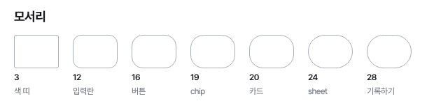

> [!NOTE]
> 이 글은 Claude와 함께 썼습니다. 사실 확인과 문장 정리는 Claude가, 판단과 경험은 제가 맡았습니다. [함께 쓰는 방식](/posts/writing-with-ai/)

> 테이스팅 노트 앱을 만들며 겪은 이야기다. 1단계 기록: [디자인을 코드로 옮기기](/posts/tastingnote-stage-1/)

## 들어가며

1단계는 Claude가 미션을 내면 내가 빈칸을 채워 푸는 방식으로 진행했다. 미션대로만 따라가도 화면은 나왔을 것이다.

그런데 돌아보니 지금 코드의 모양을 정한 건 미션보다 중간에 던진 질문들이었다. 받은 코드가 어딘가 걸릴 때 그냥 넘어가지 않고 물어본 순간들이다. 그런 순간이 세 번 있었다.

## 1. 받은 코드를 다시 보다

글꼴을 넣는 미션이었다. 앱에서 쓰는 글자 스타일 10가지에 같은 글꼴과 같은 자간(글자 사이 간격)을 넣으라는 내용이었고, 그대로 했다.

```kotlin
displayLarge = TextStyle(fontFamily = Pretendard, letterSpacing = (-0.03).em, ...)
displayMedium = TextStyle(fontFamily = Pretendard, letterSpacing = (-0.03).em, ...)
// ... 스타일마다 같은 값이 10번
```

다 하고 나서 물었다.

> 다 했어. letterSpacing은 동일한데 한 곳에서 관리 못 해?

된다는 답이 돌아왔다. 공통 값만 담은 기본 스타일을 하나 만들고, 나머지는 그걸 복사해 다른 부분만 바꾸는 방식이다.

```kotlin
private val Base = TextStyle(fontFamily = Pretendard, letterSpacing = (-0.03).em)

displayLarge = Base.copy(fontSize = 48.sp, ...)
displayMedium = Base.copy(fontSize = 40.sp, ...)
```

반복되던 20줄이 2줄이 됐다. 자간을 바꾸고 싶으면 이제 한 줄만 고치면 된다.

## 2. 빈틈을 짚고, 끝까지 따져 보다

다음은 모서리 둥글기였다. 디자인 기준표에는 모서리 값이 7가지 있다.


*디자인 기준표의 모서리 7가지. 숫자가 클수록 더 둥글다*

**처음 설계.** Android(Material)에는 모서리 값을 넣어 두는 칸이 5개 있다. 이 칸에 넣어 두면 카드나 입력란 같은 부품이 알아서 꺼내 쓴다. Claude는 부품이 쓰는 5개만 이 칸에 넣고, 남은 2개(색 띠, 기록하기 버튼)는 쓰는 화면에서 직접 적자고 했다.

```kotlin
val Shapes = Shapes(                          // Material의 5칸
    extraSmall = RoundedCornerShape(12.dp),   // 입력란
    small = RoundedCornerShape(19.dp),        // chip
    medium = RoundedCornerShape(20.dp),       // 카드
    large = RoundedCornerShape(16.dp),        // 버튼
    extraLarge = RoundedCornerShape(24.dp),   // 아래에서 올라오는 창(sheet)
)
// 색 띠(3), 기록하기(28)는 나중에 각 화면에서
```

**첫 번째 질문.**

> 모서리 7개인데 5개만 정의하는거야?

같은 모서리 값인데 왜 2개만 다르게 다루는지가 걸렸다. Claude도 "값은 한곳에 모은다"는 원칙과 어긋났다고 인정했고, 남은 2개를 `Corner`라는 이름으로 따로 모았다.

**두 번째 질문.** 그래도 5개는 Material의 칸에, 2개는 `Corner`에 나뉘어 있었다.

```kotlin
val Shapes = Shapes(                          // 5개는 여기
    extraSmall = RoundedCornerShape(12.dp),   // 입력란
    small = RoundedCornerShape(19.dp),        // chip
    medium = RoundedCornerShape(20.dp),       // 카드
    large = RoundedCornerShape(16.dp),        // 버튼
    extraLarge = RoundedCornerShape(24.dp),   // 아래에서 올라오는 창
)

object Corner {                               // 2개는 여기
    val band = RoundedCornerShape(3.dp)       // 색 띠
    val record = RoundedCornerShape(28.dp)    // 기록하기 버튼
}
```

> 근데 shape, corner를 다르게 설정한 이유가 있어? shape에 통합하면 안 되는거야?

Material의 칸은 5개로 정해져 있어서 그쪽으로는 합칠 수 없었다. 대신 반대로, 7개를 모두 `Corner`에 모으고 Material의 칸은 그걸 가리키기만 하게 할 수 있었다. Claude는 이 방법을 추천했다.

**추천을 따져 보기.** 바로 받지 않고 두 번 더 물었다.

> 통합하면 Shapes는 왜 필요해? 기본값 때문에?

통합해도 같은 값을 `Corner`와 `Shapes` 두 곳에서 다루는 건 마찬가지였다. 그럴 바엔 `Shapes`를 없애고 `Corner`만 남겨도 되지 않을까 싶었다.

답은 짐작대로 기본값 때문이었다. 부품들이 Material의 칸에서 값을 꺼내 쓰니, 그 칸이 없어지면 부품마다 모서리를 일일이 지정해야 한다.

> 그래도 통합하는 것을 추천?

이번에는 단점도 들었다. 같은 모서리를 부르는 이름이 두 가지가 되고, 인터넷 예제는 대부분 Material 쪽 이름을 쓴다. "화면에서는 `Corner`만 쓴다"는 규칙을 두기로 하고 통합했다.

```kotlin
object Corner {                             // 숫자 7개는 여기에만
    val band = RoundedCornerShape(3.dp)     // 색 띠
    val input = RoundedCornerShape(12.dp)   // 입력란
    val button = RoundedCornerShape(16.dp)  // 버튼
    val chip = RoundedCornerShape(19.dp)    // chip
    val card = RoundedCornerShape(20.dp)    // 카드
    val sheet = RoundedCornerShape(24.dp)   // 아래에서 올라오는 창
    val record = RoundedCornerShape(28.dp)  // 기록하기 버튼
}

val Shapes = Shapes(                        // Material의 5칸은 가리키기만
    extraSmall = Corner.input,
    small = Corner.chip,
    medium = Corner.card,
    large = Corner.button,
    extraLarge = Corner.sheet,
)
```

## 3. 내 안을 내고, 비교해서 고르다

**질문.** 버튼 색을 넣는 미션에서 `DisabledBg`(누를 수 없는 버튼의 바탕색) 같은 이름이 생겼다. Android 기본 색은 `Color.White`처럼 앞에 `Color.`가 붙는데, 우리 색에는 아무것도 붙지 않았다.

> 어디는 Color.xxx인데 우리는 DisabledBg 이렇게 사용하잖아. 그럼 이게 색상인 걸 어떻게 알 수 있을까나

**Claude의 안.** 색을 `Palette`라는 묶음에 모아 `Palette.disabledBg`처럼 쓰자고 했다. 여백(`Spacing`), 모서리(`Corner`)와 같은 모양이 된다.

**내 안.** 이번에는 내가 다른 방법을 냈다.

> 아니면 Color의 확장 함수? 그런 느낌은?

Kotlin에서는 `Color`에 이름을 덧붙여 `Color.DisabledBg`처럼 쓸 수도 있다. 기본 색과 모양이 같아지는 장점이 있다.

**비교.** 둘을 나란히 놓았다.

| | `Color.DisabledBg` (내 안) | `Palette.disabledBg` |
|---|---|---|
| 이름만 봐도 색인 줄 앎 | ✅ | ✅ |
| 기본 색과 모양이 같음 | ✅ | ✗ |
| 우리 색과 기본 색이 구분됨 | ✗ 섞임 | ✅ |
| 여백·모서리와 같은 방식 | ✗ | ✅ |

결정적인 건 세 번째 줄이었다. 이 앱은 "기준표에 있는 색만 쓴다"가 원칙이다. 그런데 `Color.`를 치면 기준표에 없는 기본 색(`Color.Red` 같은)까지 같은 목록에 뜬다. `Palette.`를 치면 우리 색만 나온다.

그래서 내 안 대신 `Palette`를 골랐다.

## 돌아보며

세 장면 모두 시작은 Android 지식이 아니었다. 같은 게 반복된다, 값이 흩어져 있다, 이름만 봐서는 모르겠다. 원래 코드를 짤 때 걸리던 것들이 처음 보는 Android에서도 똑같이 걸렸을 뿐이다.

질문은 내가 던졌지만, 답까지 혼자 찾은 건 아니다. Claude가 내놓은 선택지를 따져 보고 골랐다. 마지막 장면처럼 내 안을 접고 Claude의 안을 고른 적도 있다.

Claude는 대부분 잘 이끌어 줬다. 그래도 모서리 장면처럼 스스로 세운 원칙을 놓칠 때가 있었다. 받은 답을 그대로 믿지 말고 한 번 더 들여다봐야 한다는 걸 다시 느꼈다.
