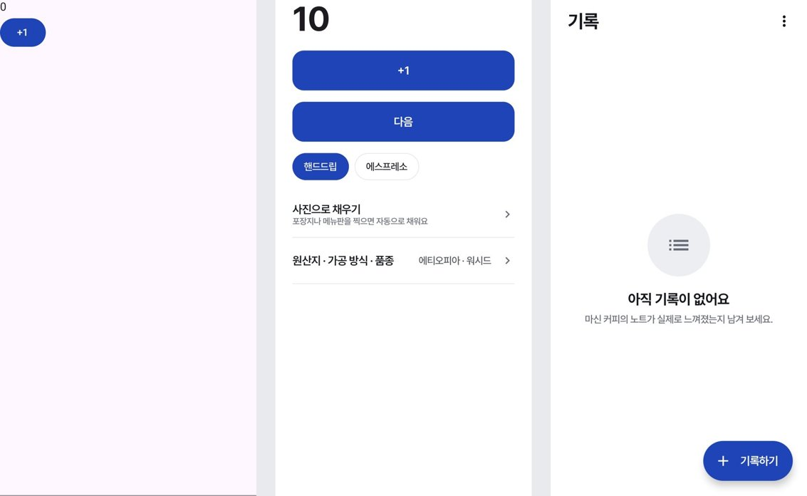
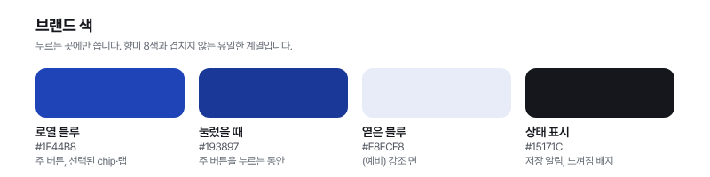
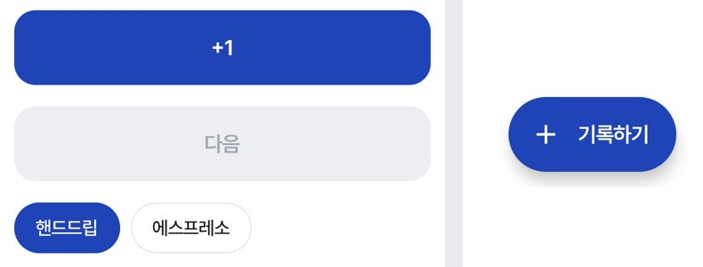
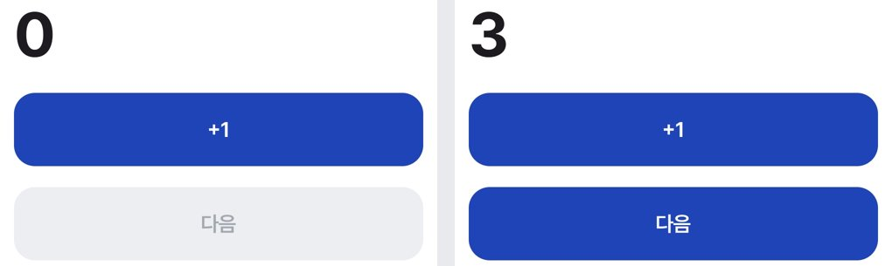
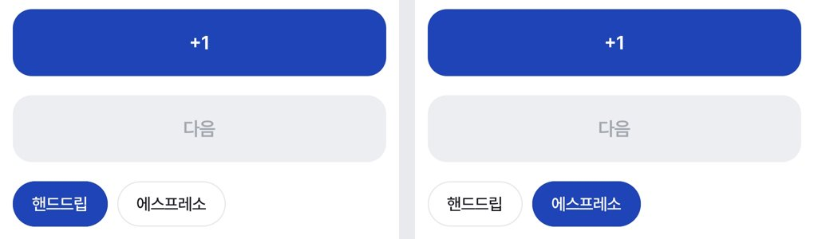

> [!NOTE]
> 이 글은 Claude와 함께 썼습니다. 사실 확인과 문장 정리는 Claude가, 판단과 경험은 제가 맡았습니다. [함께 쓰는 방식](/posts/writing-with-ai/)

> 테이스팅 노트 앱을 처음부터 만들어 가는 기록이다.
> 이전: [0단계 · 포장지에 적힌 맛, 정말 느껴질까](/posts/why-tastingnote/)

## 이번 단계의 목표

0단계는 아무 기능 없는 기본 앱을 휴대폰에 설치해 실행해 본 데서 끝났다. 1단계의 목표는 두 가지였다.

- Android 화면을 코드로 그리는 도구인 Compose가 화면을 어떻게 그리는지 손으로 익힌다.
- 미리 그려 둔 디자인에서 정해 둔 값(색, 글자, 여백, 모서리)과 공통 부품을 코드로 옮기고, 그걸로 첫 화면 하나를 그린다.

## 거쳐 온 길

Claude가 내 준 미션 16개를 하나씩 받아 빈칸을 채우며 풀었다. 성격별로 묶으면 네 덩어리다.

| 묶음 | 한 일 |
|---|---|
| 1. Compose 손에 익히기 | 숫자 카운터로 "값이 바뀌면 화면이 다시 그려진다" 익히기 |
| 2. 디자인 값 옮기기 | 색·글자·여백·모서리를 한곳에 모으기 |
| 3. 공통 부품 만들기 | 버튼, chip, 줄 |
| 4. 첫 화면과 정리 | 기록 탭 빈 화면, 개발 PC 두 대 맞추기 |

## 화면은 이렇게 바뀌었다


*왼쪽부터 ① 버튼 색만 바꿨을 때 ② 연습 화면 ③ 첫 화면*

① **버튼 색만 바꿨을 때.** 나머지는 프로젝트를 만들 때 딸려 온 기본 화면 그대로라, 바탕은 옅은 분홍빛이고 숫자도 작다.

② **디자인 값과 부품을 다 넣은 연습 화면.** 글자 크기, 여백, 모서리를 미리 정해 둔 값으로 맞췄고, 앞으로 여러 화면에서 쓸 부품 세 가지를 만들었다. 꽉 찬 파란 버튼, 여러 개 중 하나를 고르는 작은 버튼(chip), 눌러서 다른 화면으로 넘어가는 목록 한 줄이다.

③ **마지막으로 그린 첫 화면.** 앱을 처음 켜면 보이는 기록 탭이다. 하단 탭은 3단계(화면 이동)에서 붙인다.

## 정한 것들

### 디자인 값은 한곳에 모았다

앱을 만들기 전에 디자인부터 그리면서 색, 글자 크기, 여백, 모서리 둥글기를 기준표로 정해 두었다. 글자 크기는 10가지, 여백은 4의 배수만 쓰는 식이다. 브랜드 색인 로열 블루는 화면에서 가장 중요한 버튼(주 버튼)과 선택된 chip에 쓰기로 했다.


*디자인 기준표의 브랜드 색. 맨 왼쪽이 로열 블루*

그러다 보니 실제 화면에서도 같은 파란색이 여러 곳에 나온다. 이 색을 쓰는 곳마다 숫자로 적어 두면 나중에 색을 바꿀 때 하나씩 찾아 고쳐야 하고, 하나라도 빠뜨리면 그곳만 색이 달라진다.


*같은 로열 블루가 쓰인 세 곳: 주 버튼, 선택된 chip, 기록하기 버튼*

그래서 값은 한 파일에 이름을 붙여 모아 두고, 화면에서는 이름만 쓰기로 했다. 아래 한 줄을 바꾸면 세 곳이 함께 바뀐다.

```kotlin
object Palette {
    val brand = Color(0xFF1E44B8)   // 로열 블루
}
```

여백, 모서리, 글자 크기도 같은 방식으로 모았다. 옮기다 보니 디자인 그림 몇 곳이 기준표 규칙을 벗어나 있었는데(17px 글자, 14px 여백 같은 것), 그런 곳은 규칙 쪽에 맞춰 16, 12로 바꿨다.

### 부품은 모양만, 할 일과 상태는 화면이

버튼이나 chip 같은 부품은 "눌렸다"는 사실만 알리고, 눌렸을 때 무엇을 할지와 지금 무엇이 골라져 있는지는 그 부품을 쓰는 화면이 정한다. 그래야 같은 부품을 여러 화면에서 그대로 다시 쓸 수 있다.

이렇게 나눠 두면 좋은 점이 하나 더 있다. 화면이 값을 바꾸면, 그 값을 쓰는 부품은 알아서 다시 그려진다.

연습 화면에서는 숫자가 3 이상일 때만 "다음" 버튼을 누를 수 있게 해 봤다. 숫자가 바뀔 때마다 버튼이 스스로 켜지고 꺼진다. 나중에 원두를 등록할 때 제품명을 적어야 저장 버튼이 켜지게 하는 것도 같은 방식이다.


*숫자가 3이 되자 "다음" 버튼이 켜졌다*

chip도 같다. 화면은 "지금 고른 방식" 하나만 기억한다. 에스프레소를 누르면 그 값만 바뀌고, 두 chip은 그 값을 보고 각자 다시 그려진다. 핸드드립의 선택을 따로 풀어 줄 필요가 없다.


*에스프레소를 누르자 선택이 옮겨 갔다*

<details>
<summary>코드로 보면</summary>

```kotlin
// 숫자(count)가 3 이상일 때만 누를 수 있다
BrandButton(text = "다음", onClick = { }, enabled = count >= 3)

// method: 지금 고른 방식. chip을 누르면 이 값만 바꾼다
BrandChip(text = "핸드드립", selected = method == "핸드드립", onClick = { method = "핸드드립" })
BrandChip(text = "에스프레소", selected = method == "에스프레소", onClick = { method = "에스프레소" })
```

</details>

### 그 밖에

- **늘 밝은 화면만 쓴다.** 향미를 8가지 색으로 보여 주는 앱이라 그 색이 잘 보이는 흰 바탕을 기준으로 디자인했다. 그래서 다크 모드나, 배경화면 색을 따라 앱 색이 바뀌는 기능(dynamic color)은 쓰지 않는다.
- **개발용 서명 키를 PC끼리 맞추는 중이다.** Android는 서명 키로 "같은 앱인지"를 확인하는데, 개발용 키가 PC마다 달라서 Mac과 Windows를 오갈 때마다 앱을 지워야 했다. 2단계부터는 앱을 지우면 기록도 사라지니, 그 전에 키 하나를 코드 저장소(GitHub)에 넣어 두 PC가 함께 쓰게 했다. 비밀번호까지 공개된 연습용 키라 괜찮고, 스토어에 올릴 때 쓰는 키는 절대 넣지 않는다. Windows에서 잘 되는지는 다음 글에서 확인한다.
- **배우는 순서를 바꿨다.** 처음에는 미션 전에 동작을 예측하는 질문을 받았는데, 해 보지 않은 걸 맞히기는 어려웠다. 그래서 1단계 중간에 질문을 미션 뒤로 옮겼다.

## 1단계를 끝내며

처음 해 보는 Android 개발이었는데, 단계별로 하나씩 하다 보니 생각보다 잘 따라갔다.

아직 궁금한 게 많다. 제일 많이 헤맨 건 기본값. 스타일을 준 적도 없는 버튼 글자가 왜 바뀌는지, 바탕은 왜 분홍빛인지. 막힐 때마다 물어보면서 하나씩 알아 가는 중이다.
