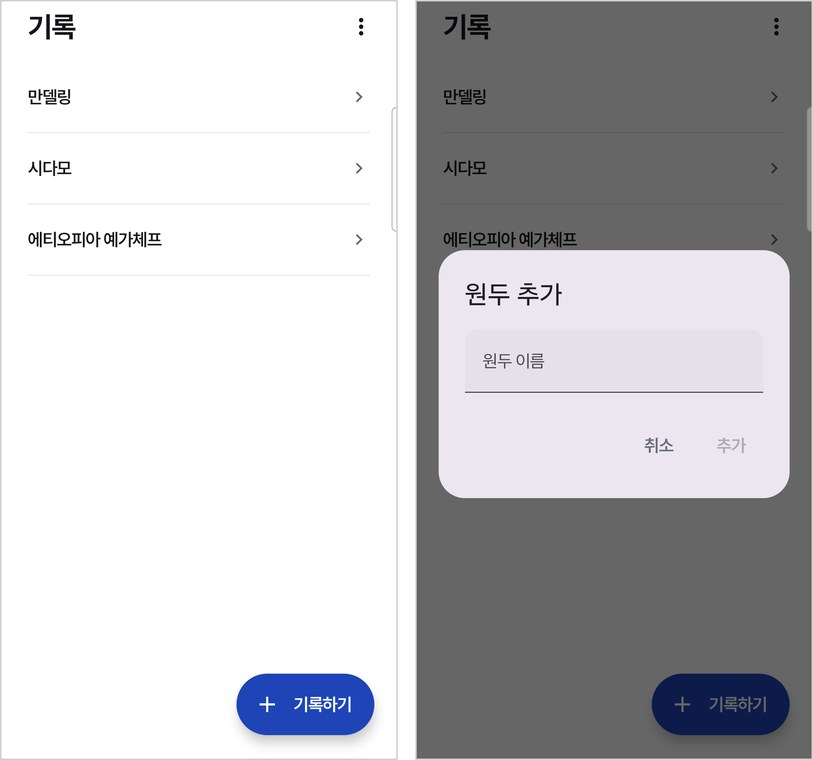

> [!NOTE]
> 이 글은 Claude와 함께 썼습니다. 사실 확인과 문장 정리는 Claude가, 판단과 경험은 제가 맡았습니다. [함께 쓰는 방식](/posts/writing-with-ai/)

> 테이스팅 노트 앱을 처음부터 만들어 가는 기록이다.
> 이전: [1단계 · 디자인을 코드로 옮기기](/posts/tastingnote-stage-1/)

## 이번 단계의 목표

1단계는 기록 탭의 빈 화면 하나를 그린 데서 끝났다. 그 화면에는 아직 아무것도 저장되지 않았다. "기록하기"를 눌러도 일어나는 일이 없고, 앱을 끄면 전부 처음으로 돌아간다.

2단계의 목표는 기록이 남게 하는 것이었다.

- 휴대폰 안에 데이터베이스(DB)를 만들어 원두를 입력하면 저장되고, 앱을 껐다 켜도 남아 있게 한다.
- 앞으로 향미를 고를 때 쓸 향미 사전을 앱 안에 넣어 둔다.

서버는 아직 없다. 기록은 휴대폰에만 저장한다.

## 거쳐 온 길

미션 12개를 세 덩어리로 나눠 풀었다.

| 묶음 | 한 일 |
|---|---|
| 1. DB 기초 | 휴대폰 안에 DB를 만들고 원두 표(테이블)를 정의하기 |
| 2. 화면과 연결 | 저장된 원두를 목록으로 보여 주고, 입력 창으로 새 원두를 추가하기 |
| 3. 향미 사전 | 향미 99개와 표기 290개를 처음 실행할 때 DB에 넣기 |

DB는 Android에서 많이 쓰는 Room이라는 도구로 만들었다. 휴대폰마다 들어 있는 SQLite라는 작은 DB를 코드에서 편하게 쓰게 해 준다.

## 화면은 이렇게 바뀌었다


*왼쪽 ① 쌓인 목록, 오른쪽 ② 원두 추가 입력 창*

① **추가한 원두가 목록에 쌓인다.** 1단계에서 그린 빈 화면 자리에 이제 원두가 보인다. 새로 추가한 원두가 맨 위에 오고, 앱을 완전히 껐다가 다시 켜도 그대로 남아 있다.

② **"기록하기"를 누르면 뜨는 입력 창.** 원두 이름을 적고 "추가"를 누른다. 이름이 비어 있으면 사진처럼 "추가"가 흐리고 눌리지 않는다.

향미 사전은 아직 화면에 나오지 않는다. 향미를 고르는 화면은 4단계에서 만든다. 대신 Android Studio의 Database Inspector(실행 중인 앱의 DB를 표로 보여 주는 도구)로 DB 안을 열어, 향미가 빠짐없이 들어갔는지 세어 봤다.

```sql
SELECT level, COUNT(*) FROM flavors GROUP BY level;
```

| level | 뜻 | 개수 |
|---|---|---|
| 1 | 대분류 (과일, 견과 등) | 8 |
| 2 | 중분류 (베리, 건과일 등) | 11 |
| 3 | 세부 (블루베리, 복숭아 등) | 80 |

합쳐서 99개, 표기(향미 이름 자체와 "peach", "백도" 같은 다른 이름)는 290개로 사전과 같았다. 앱을 껐다 켠 뒤에 다시 세어도 그대로여서, 두 번 들어가지 않는 것까지 확인했다.

## 정한 것들

### 원두 번호는 앱이, 향미 번호는 사전이 정한다

DB의 표에서는 행마다 다른 것과 겹치지 않는 번호(id)를 붙인다. 원두와 향미는 이 번호를 붙이는 방식이 다르다.

원두는 내가 이 휴대폰에서 만드는 데이터라, 저장할 때마다 앱이 1, 2, 3… 차례로 번호를 붙인다.

향미는 사전에서 온 고정 데이터라 번호를 사전이 미리 정해 둔다. 나중에 기록(노트)이 "이 원두에서 향미 몇 번을 느꼈다"처럼 향미 번호를 가리키게 되기 때문이다. 넣은 순서로 번호를 붙이면, 사전을 고치면서 중간에 향미 하나를 끼워 넣는 순간 뒤쪽 번호가 밀린다. 그러면 예전 기록이 엉뚱한 향미를 가리킨다. 백업한 기록을 다른 휴대폰에 옮길 때도 두 휴대폰의 번호가 같다는 보장이 없다.

그래서 향미 번호는 "과일/베리/블루베리" 같은 이름 경로로 만든 긴 문자열(UUID)을 쓴다. 같은 경로면 언제 어디서 만들어도 같은 값이 나온다.

### 화면 조각은 "이 이름으로 추가해 줘"라고 알리기만 한다

1단계에서 버튼과 chip은 "눌렸다"는 사실만 알리고, 무엇을 할지는 화면이 정하게 했다. 2단계에서 입력 창도 같은 방식으로 만들었다.

입력 창은 원두 이름을 받아 "이 이름으로 추가해 줘"라고 바깥에 알리기만 한다. DB에 넣는 일은 맨 위의 한 곳(ViewModel이라는, 화면의 데이터를 맡는 객체)만 한다.

```
ViewModel ── 원두 목록 ──▶ 기록 화면 ── 열렸는지 ──▶ 입력 창
    ▲                         │                      │
    └── 추가(이름) ◀──────────┴── 추가해 줘(이름) ◀──┘
```

값(목록, 입력 창이 열렸는지)은 아래로 내려가고, 일어난 일(추가해 줘)은 위로 올라간다. 이렇게 하면 입력 창은 DB를 몰라도 된다. 나중에 "원두 이름 고치기"를 만들 때도 같은 입력 창을 제목만 바꿔 쓰고, 알림을 받는 쪽에서 저장 대신 수정을 하면 된다.

### 사전은 처음 켤 때 한 번만 넣는다

향미 사전은 미리 JSON 파일(`seed.json`)로 만들어 두었다. 이 파일을 앱 안에 함께 넣고, 앱이 켜질 때마다 "향미 표가 비어 있나?"부터 확인한다. 비어 있을 때만 파일을 읽어 넣고, 이미 있으면 바로 넘어간다.

향미 99개와 표기 290개는 한 번에 묶어서 넣는다. 중간에 하나라도 실패하면 전부 취소돼서, 향미만 들어가고 표기는 빠진 어중간한 상태가 생기지 않는다.

파일을 읽을 때는 "파일 모양 그대로인 클래스"로 먼저 읽고, 그걸 "DB에 넣는 모양"으로 옮긴다. 둘이 거의 같지만 일부러 나눴다. 파일 쪽 이름이 바뀌어도(예: `name_ko` → `name`) 읽는 쪽 한 줄만 고치면 되고, DB 구조는 건드리지 않아도 된다.

```kotlin
// 파일 모양: JSON 키 이름을 아는 곳은 여기뿐
@Serializable
data class SeedFlavor(
    val id: String,
    @SerialName("name_ko") val nameKo: String,
    // ...
)
```

### 그 밖에

- **표기는 향미와 같은 곳에서 다룬다.** 향미 하나에는 "복숭아, peach, 백도, 피치"처럼 여러 표기가 딸려 있다. DB를 다루는 코드 묶음(DAO)을 표마다 따로 만들지 않고, 표기는 향미 쪽에 함께 두었다.
- **앱을 지우면 기록도 사라진다.** DB는 휴대폰 안의 파일이라 앱을 껐다 켜도 남지만, 앱을 지우거나 "데이터 삭제"를 누르면 함께 지워진다. 기록을 파일로 내보내고 가져오는 백업은 8단계에서 만든다.
- **표를 늘릴 때는 DB 버전을 올린다.** 향미 표 2개를 추가하면서 DB 버전을 1에서 2로 올렸다. 휴대폰에 이미 있는 버전 1 파일을 버전 2로 고쳐 주는 과정이 필요한데, Room이 두 버전의 구조를 비교해 알아서 만들어 줬다. 이미 넣어 둔 원두 3개는 그대로 남았다.

## 2단계를 끝내며

DB를 다루는 단계라 그런지 0, 1단계보다 익숙했다. 필요한 객체를 안에서 만들지 않고 생성자로 밖에서 넣어 주는 방식(DI)처럼 백엔드에서 늘 보던 구조가 보였고, 그렇게 나눠 두면 미리보기나 테스트, 나중에 고치기가 왜 편한지도 보여서 따라가기 수월했다.

그런데 0, 1단계에서 만든 화면은 내가 직접 짠 코드인데도 벌써 가물가물하다. 계속 보다 보면 익숙해지겠지.
